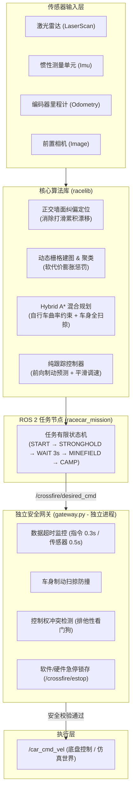

# 穿越火线：阿克曼智能车 ROS 2 仿真与实车自主导航系统 (v2)

> **面向无颜色线上赛的阿克曼底盘自主导航、雷区避障与实车安全部署方案。**  
> 运行平台：ROS 2 Humble / Python 3.10+ | 硬件适配：阿克曼转向小车（支持昇腾 ARM64 边缘计算平台）

---

## 目录

- [一、 任务与技术背景](#一-任务与技术背景)
- [二、 系统整体架构](#二-系统整体架构)
- [三、 项目目录结构](#三-项目目录结构)
- [四、 快速上手指南](#四-快速上手指南)
  - [1. 启动现场 Web 可视化配置](#1-启动现场-web-可视化配置)
  - [2. 默认本机仿真（无需 Docker / ROS）](#2-默认本机仿真无需-docker--ros)
  - [3. 完整原生 ROS 仿真（已有 Humble 时）](#3-完整原生-ros-仿真已有-humble-时)
  - [4. 工程自检与全量回归测试](#4-工程自检与全量回归测试)
- [五、 实车部署与安全防线](#五-实车部署与安全防线)
  - [1. 部署流程（无侵入安装）](#1-部署流程无侵入安装)
  - [2. 独立安全网关（第二道防线）](#2-独立安全网关第二道防线)
  - [3. 实车解锁（--arm）前提条件](#3-实车解锁--arm前提条件)
- [六、 运动预设与配置体系](#六-运动预设与配置体系)
- [七、 NPU/GPU 视觉加速与双模式切换](#七-npugpu-视觉加速与双模式切换)
- [八、 CPU 规划算法 C++ 原生加速](#八-cpu-规划算法-c-原生加速)
- [九、 核心文档导航](#九-核心文档导航)

---

## 一、 任务与技术背景

### 1. 竞赛任务流程
在 $7.0\text{m} \times 4.0\text{m}$ 的封闭矩形场地内，小车全自主完成以下阶段：
- **起始建图**：车辆保持静止，用起始位姿的多帧 360° 雷达数据建立初始锥桶地图（默认约 2 s / 至少 5 帧；阿克曼底盘不原地旋转）;
- **起点出发**：向指定据点导航（显式选择路线 A 或路线 B）；
- **据点停驻**：到达据点中心区域，在车速彻底归零后**静止等待至少 3 秒**；
- **局部脱困**：若地图更新后当前车体与融合障碍重叠，先用短距、带后向净空和扫掠检查的倒车弧尝试脱离，再重新规划；连续失败才停车；
- **穿越雷区**：自主穿过多道非等间距的密集锥桶封锁线，连续动态避障；
- **到达营地**：安全驶入对应的终点营地，平稳刹停并锁存完成。

### 2. v2 版本关键改进
- **纯几何无颜色方案**：线上赛场地物料均为无色/灰色，摒弃起步色卡与地贴颜色检测，完全依靠激光雷达、IMU 和里程计进行几何特征提取与障碍聚类。
- **严格阿克曼运动学约束**：小车底盘转向受最小转弯半径限制，严禁差速原地转向。规划器优先搜索全程前进路径，倒车仅作为受距离上限约束（单次最多 0.66m）的应急机动。
- **前摄同向视锥修正**：前置单目相机始终固定朝向车头，在轨迹视频中同步渲染视锥与行进方向指示。

---

## 二、 系统整体架构

整个系统采用分层解耦与独立安全隔离设计：



---

## 三、 项目目录结构

```text
racecar/
├── crossfire               # 统一入口：安装、环境检查、配置界面、测试、只读运行、本机/ROS 仿真
├── racelib/                # 核心算法库（Python + 可选 C++，无 ROS 依赖）
│   ├── ackermann.py        # 基于自行车模型的 Hybrid A* 混合路径规划与扫掠碰撞检测
│   ├── localization.py     # 场地墙面正交投影修正定位算法
│   ├── lidarproc.py        # 激光点云聚类、圆拟合与障碍物提取
│   ├── gridmap.py          # 动态代价地图、栅格膨胀与软惩罚机制
│   ├── control.py          # 纯跟踪 (Pure Pursuit) 与速度平滑控制器
│   └── mission.py          # 顶层任务状态机
├── ros2_ws/                # ROS 2 Humble 工作空间
│   └── src/racecar_mission/
│       ├── racecar_mission/mission_node.py   # 主任务节点
│       ├── racecar_mission/gateway.py        # 独立运行的第二道防线：安全网关
│       ├── racecar_mission/preflight.py      # 只读起飞前硬件与配置自检
│       └── racecar_mission/calibrate_drive.py# 底盘转向舵机与油门 PWM 标定工具
├── sim/                    # 仿真系统
│   ├── runner.py / cli.py  # 快速算法级仿真器（算法闭环，可选择 C++/Python 规划）
│   ├── ros_demo.py         # 真实 ROS 2 DDS 闭环（自行车运动学、传感器噪声与碰撞检查）
│   └── camera.py           # 视锥投影与相机观测生成
├── config/                 # 默认配置
│   ├── field.json          # 场地外框与区域定义
│   ├── robot.json          # 车辆几何与运动学参数（轴距、最大舵角、外廓尺寸）
│   ├── vehicle_profile.json# 实车专用话题与硬件安全确认项（默认全锁定）
│   └── route_a.json / route_b.json # A/B 路线航点定义
├── profiles/               # 现场实测配置与历史快照（由可视化工具生成）
├── models/                 # 可复现的 RGB 阈值 ONNX 图及模型说明
├── tools/                  # 运维、测试与启动工具脚本
│   ├── configure.sh        # 一键启动 Web 配置与本机测试界面
│   ├── config_editor.py    # 仅回环监听；保存配置并可启动隔离的本机仿真
│   ├── native_runtime.py  # 原生私有运行环境，不调用 colcon 或 ros2 run
│   ├── run_local_sim.py   # 本机无 Docker 仿真，支持已保存或临时配置
│   ├── run_ros_sim.sh      # 可选的旧 Docker 仿真
│   ├── selfcheck.sh        # 单元测试与闭环验证；--quick 为快速模式
│   └── package_release.py  # 打包实车独立自解压发布包
├── ui/                     # 配置 + 本机测试前端静态文件 (HTML/JS)
├── docs/                   # 技术文档与标定指南
│   ├── competition/        # 赛题规格说明与传感器物料资料
│   ├── evidence/           # 历史实车底盘驱动证据与实测数据
│   └── ...                 # 系统架构、部署指南、测试报告与标定清单
└── release/                # 实车交付包与校验和文件
```

---

## 四、 快速上手指南

### 1. 启动现场 Web 可视化配置
在现场遇到场地微调、封锁线间距变动或围栏歪斜时，运行配置工具：
```bash
./crossfire ui
# 等价入口：bash tools/configure.sh
```
- 控制台将打印本地 Web 访问地址（默认 `http://127.0.0.1:8765/`，端口被占时自动顺延）。
- **配置**：拖拽起点、据点和锥桶坐标；在图上“绘制障碍”连续放置圆形障碍（可设半径、0.1m 吸附和“已知”先验）；配置歪斜围栏四角；切换保守/标准/激进三种运动预设；一键保存并导出实车/仿真通用的配置 profile。
- **本机测试**：页面内可直接运行当前配置（不必先保存），选择路线 A/B、C++/Python 规划、无颜色/颜色/色卡模式、seed 和是否录像；完成后显示结果指标、俯视图或视频，并给出播放命令。测试只调用 `tools/run_local_sim.py`，不启动 ROS、底盘或实车进程。

### 2. 默认本机仿真（无需 Docker / ROS）

```bash
./crossfire sim --route A
./crossfire sim --route B --no-video
./crossfire sim --profile measured_example --route A
./crossfire sim --use-card --card-color red --planner-engine native
mpv output/latest/video.mp4
```

默认执行同一算法与自行车模型，不含 DDS 和独立网关；需要已有 NumPy/Pillow，OpenCV/SciPy 可选，视频使用已有 ffmpeg。每次创建新结果目录，保存独立配置快照。

仿真信息边界：`SimWorld` 只负责生成物理真值和带噪声的雷达/IMU/里程计/相机样本；任务状态机只通过 `RobotIO` 接收这些传感器数据，不读取世界中的锥桶真值、真实位姿或碰撞结果。普通 `map.png`、视频俯视图和 `trajectory_estimated.csv` 使用任务自己的估计；`evaluation_truth.png`、`cones.json`、`trajectory.csv` 和 `summary.json` 中的碰撞/召回率只用于赛后评分，不参与控制。仿真视频为 2×2 面板：前置相机、任务估计地图、车体系雷达扫描/融合锥桶、任务状态；不绘制世界真值。显式传入 `--prior` 或勾选“已知”障碍时属于赛前公布信息，不属于运行时真值注入。

### 3. 完整原生 ROS 仿真（已有 Humble 时）

```bash
./crossfire install
./crossfire ros-sim --route A
./crossfire ros-sim --use-card --card-color red
```

直接启动包内节点，无需 colcon、Docker 或注册同名 ROS 包。DDS domain 和每次运行的话题前缀均隔离。电脑没有 ROS 时仍可用默认算法仿真；旧的 `bash tools/run_ros_sim.sh` 保留为可选 Docker 验证入口，不作为车端依赖。

详见 [原生安装与隔离运行](docs/09_原生安装与隔离运行.md)。

### 4. 工程自检与全量回归测试
默认运行本机单元测试、静态接口契约和算法闭环；已有原生 ROS 时可增加 DDS 与急停验证：
```bash
./crossfire test --quick            # 单元测试 + Route A，本地快速迭代
./crossfire test                    # 单元测试 + A/B/色卡闭环
./crossfire test --ros              # 需先 ./crossfire install，增加 DDS/急停
./crossfire test --docker           # 旧隔离测试，显式选择
# 等价的底层入口：
bash tools/selfcheck.sh --quick
bash tools/selfcheck.sh
```

---

## 五、 实车部署与安全防线

### 1. 部署流程（无侵入安装）
实车交付包采用绿色独立源码包，目录由你指定；不修改 `.bashrc`、系统路径或已有 ROS 工作空间：

1. 将绿色压缩包 `release/crossfire-car-v2.tar.gz` 拷贝到小车（例如昇腾开发板）。Linux 推荐此格式，可保留脚本执行权限。
2. 普通用户指定一个**尚不存在**的目录，解压不会执行包内程序：
   ```bash
   DEST="$HOME/my-crossfire-v2"
   mkdir -m 700 -- "$DEST" &&
   tar -xzf crossfire-car-v2.tar.gz --strip-components=1 --keep-old-files -C "$DEST" &&
   cd -- "$DEST"
   ```
3. 准备运行时再执行下列命令；仅使用已有依赖，在本目录内编译 C++，无需 colcon：
   ```bash
   ./crossfire install
   ./crossfire doctor
   ./crossfire run A --preflight
   ./crossfire run A  # 默认只读，无速度发布者
   ```

上述命令只有新目录创建成功才解压，已有目标目录（包括空目录）会停止。可整体移动目录，在相同机器环境下无需修改路径配置；换到其他架构需重新准备。缺 ROS 时不自动安装或升级系统包。`.run` 作为可选的解压前校验工具保留。自选 ROS/Python、迁移、卸载与写入范围见 [绿色安装指南](docs/09_原生安装与隔离运行.md)。

### 2. 独立安全网关（第二道防线）
实车运行时，底盘控制指令**禁止**由算法节点直连底盘，必须流经独立的 `gateway` 节点：
- **心跳超时熔断**：控制指令中断 >0.30s 或雷达数据中断 >0.50s，立即归零停车；
- **全车扫掠防护**：实时预测制动停止区间，若扫掠轨迹上出现障碍物，即刻强制刹停；
- **排他性看门狗**：检测到底盘话题存在第三方竞争发布者时，立即锁存停车；
- **硬件/软件急停**：订阅 `/crossfire/estop`（Bool true），触发后锁存急停，必须人工复位。

### 3. 实车解锁（`--arm`）前提条件
> [!WARNING]
> 交付包中默认处于硬件锁定状态，`config/vehicle_profile.json` 中的确认项全部为 `false`。
> **严禁在未完成架空核实的情况下直接发车！**

只有按 [实车适配与标定清单](docs/06_实车适配与标定清单.md) 完成：
1. 传感器坐标外参核实；
2. 舵机中位与最大转角标定；
3. 油门 PWM 线性区与死区测定；
4. 底盘失联自锁保护确认。

并在配置文件中完成确认后，方可使用 `--arm` 解锁控制：
```bash
bash tools/run_car.sh A --arm
```

---

## 六、 运动预设与配置体系

系统内置三种运动参数预设，可通过配置工具或命令行参数切换：

| 预设模式 | 最高前进线速 | 最高角速度 | 转弯与避障特征 | 推荐适用场景 |
| :--- | :---: | :---: | :--- | :--- |
| **保守 (conservative)** | $0.25\text{ m/s}$ | $0.50\text{ rad/s}$ | 较大膨胀安全余量，大半径平缓入弯 | 首次上车测试、未知复杂雷区 |
| **标准 (standard)** | $0.35\text{ m/s}$ | $0.70\text{ rad/s}$ | 平衡速度与安全余量，兼顾通过率 | 默认推荐，稳定完赛 |
| **激进 (aggressive)** | $0.50\text{ m/s}$ | $1.00\text{ rad/s}$ | 紧凑安全边界，动态快速响应 | 追求极限完赛用时 |

---

## 七、 NPU/GPU 视觉加速与双模式切换

默认无颜色模式保持手动选路 A/B，不加载模型。色卡模式要求连续两帧确认，超时停车；所有锥桶均避让。

```bash
./crossfire sim --route A
./crossfire sim --route B
./crossfire sim --use-card --route A --ai-backend fast_color
```

ONNX 和 NPU 现已接通色卡推理调用；显式指定后端但缺模型或运行库会报错。只有 `auto` 允许回退，结果中记录实际后端、执行器和原因。ONNX 已在本机 CPU 验证，昇腾 NPU 与 CUDA 尚未实测。锥桶和地贴颜色仍由 CPU 处理。

```bash
# 需要当前 Python 已有兼容 ONNX Runtime；不自动安装
./crossfire sim --use-card --ai-backend onnx --ai-model models/card_classifier.onnx
# 车端先保持只读
./crossfire run A --use-card --ai-backend onnx --ai-model models/card_classifier.onnx
```

附带的模型是可复现 RGB 阈值图，不是训练好的 CNN；不支持直接挂载 YOLO。协议、实车配置与已知边界见 [视觉加速指南](docs/07_NPU与GPU视觉加速指南.md)。

## 八、 CPU 规划算法 C++ 原生加速

C++ 执行 Hybrid A* 搜索、二维 Dijkstra 启发式与整车矩形扫掠碰撞检查，Python 保留任务、感知、跟踪和安全网关。`ctypes.CDLL` 调用期间释放 GIL；这有助于并行接收传感器，不等于控制循环无抖动。

本次修正了固定尺寸状态表越界别名、节点扩容引用失效、顺逆时针围栏判断及搜索超时。规划余量不会降到执行保护余量以下；弯道扫掠不通过时先按同一制动检查减速，无法执行再停车重规划。每次规划的倒车预算仍受限制，不是整个任务的倒车总量上限。

```bash
./crossfire sim --route A --planner-engine native
./crossfire sim --route A --planner-engine python
python3 -m tools.benchmark_planner
```

容器内重新编译当前架构的库；实车包只含 C++ 源码，在板上私有目录编译，不捆绑笔记本的 `.so`。`auto` 无原生库时选 Python，显式 `native` 不可用则报错。性能需在目标板测量，旧版 54 倍和板端延迟外推不作为当前保证。

每次仿真默认创建新目录；视频成功编码后才从 `video.partial.mp4` 改名并更新 `output/latest`。已有结果目录不会覆盖。复查流程与本次实测见 [迭代验证报告](docs/08_规划与视觉修复验证.md)。

---

## 九、 核心文档导航

| 文档名称 | 路径 | 核心内容说明 |
| :--- | :--- | :--- |
| **系统架构与算法** | [01_系统架构与算法.md](docs/01_系统架构与算法.md) | Hybrid A* 原理、墙面正交纠偏定位、状态机设计 |
| **车辆部署指南** | [02_车辆部署指南.md](docs/02_车辆部署指南.md) | 实车安装、环境变量、运行调试与撤销指引 |
| **交付验证报告** | [03_测试报告.md](docs/03_测试报告.md) | 仿真与故障注入测试数据、完赛用时、成功率统计 |
| **技术案例精选** | [04_技术文档案例.md](docs/04_技术文档案例.md) | 涵盖感知、A*、死胡同解困、定位漂移等 7 大典型技术案例 |
| **现场配置与调参** | [05_现场配置与运动调参.md](docs/05_现场配置与运动调参.md) | Web 配置编辑器使用说明、导出规范与预设解析 |
| **实车适配与标定清单** | [06_实车适配与标定清单.md](docs/06_实车适配与标定清单.md) | 首次上架必填项：底盘通信、外参对齐、舵角/油门映射 |
| **NPU/GPU 视觉加速指南** | [07_NPU与GPU视觉加速指南.md](docs/07_NPU与GPU视觉加速指南.md) | 昇腾 310B NPU 算力利用、ATC 模型转换 (ONNX $\to$ OM)、三层分工与双模式指引 |
| **本次规划与视觉修复** | [08_规划与视觉修复验证.md](docs/08_规划与视觉修复验证.md) | 首帧地图、C++、模型推理、视频与独立部署的检查及实测 |
| **原生安装与隔离运行** | [09_原生安装与隔离运行.md](docs/09_原生安装与隔离运行.md) | 一条命令安装、无 Docker 仿真、私有运行和原有环境保护 |
| **赛题规则与物料规格** | [docs/competition/](docs/competition/) | 原始赛题规则说明、传感器规格说明与现场硬件参考图 |


当前到达时间优化与固定限速对比见 [到达时间优化与验证](docs/10_到达时间优化与验证.md)。本次主要减少规划等待和尾段弯曲；130例固定输入对比保持原完赛案例和零碰撞，共同完赛案例平均全流程缩短约3.0%，不提高速度上限。板端表现仍须实测。
