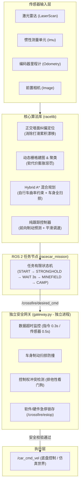

# 穿越火线：阿克曼智能车 ROS 2 仿真与实车自主导航系统 (v2)

> **面向无颜色线上赛的阿克曼底盘自主导航、雷区避障与实车安全部署方案。**  
> 运行平台：ROS 2 Humble / Python 3.10+ | 硬件适配：阿克曼转向小车（支持昇腾 ARM64 边缘计算平台）

---

## 目录

- [一、 任务与技术背景](#一-任务与技术背景)
- [二、 系统整体架构](#二-系统整体架构)
- [三、 项目目录结构](#三-项目目录结构)
- [四、 快速上手指南](#四-快速上手指南)
  - [1. 启动现场 Web 可视化配置](#1-启动现场-web-可视化配置)
  - [2. 运行本机 ROS 2 仿真（Docker 隔离）](#2-运行本机-ros-2-仿真docker-隔离)
  - [3. 快速纯算法仿真（无需 ROS）](#3-快速纯算法仿真无需-ros)
  - [4. 工程自检与全量回归测试](#4-工程自检与全量回归测试)
- [五、 实车部署与安全防线](#五-实车部署与安全防线)
  - [1. 部署流程（无侵入安装）](#1-部署流程无侵入安装)
  - [2. 独立安全网关（第二道防线）](#2-独立安全网关第二道防线)
  - [3. 实车解锁（--arm）前提条件](#3-实车解锁--arm前提条件)
- [六、 运动预设与配置体系](#六-运动预设与配置体系)
- [七、 核心文档导航](#七-核心文档导航)

---

## 一、 任务与技术背景

### 1. 竞赛任务流程
在 $7.0\text{m} \times 4.0\text{m}$ 的封闭矩形场地内，小车全自主完成以下阶段：
- **起点出发**：向指定据点导航（显式选择路线 A 或路线 B）；
- **据点停驻**：到达据点中心区域，在车速彻底归零后**静止等待至少 3 秒**；
- **穿越雷区**：自主穿过多道非等间距的密集锥桶封锁线，连续动态避障；
- **到达营地**：安全驶入对应的终点营地，平稳刹停并锁存完成。

### 2. v2 版本关键改进
- **纯几何无颜色方案**：线上赛场地物料均为无色/灰色，摒弃起步色卡与地贴颜色检测，完全依靠激光雷达、IMU 和里程计进行几何特征提取与障碍聚类。
- **严格阿克曼运动学约束**：小车底盘转向受最小转弯半径限制，严禁差速原地转向。规划器优先搜索全程前进路径，倒车仅作为受距离上限约束（单次最多 0.66m）的应急机动。
- **前摄同向视锥修正**：前置单目相机始终固定朝向车头，在轨迹视频中同步渲染视锥与行进方向指示。

---

## 二、 系统整体架构

整个系统采用分层解耦与独立安全隔离设计：



---

## 三、 项目目录结构

```text
racecar/
├── racelib/                # 核心算法库（纯 Python，解耦无 ROS 依赖）
│   ├── ackermann.py        # 基于自行车模型的 Hybrid A* 混合路径规划与扫掠碰撞检测
│   ├── localization.py     # 场地墙面正交投影修正定位算法
│   ├── lidarproc.py        # 激光点云聚类、圆拟合与障碍物提取
│   ├── gridmap.py          # 动态代价地图、栅格膨胀与软惩罚机制
│   ├── control.py          # 纯跟踪 (Pure Pursuit) 与速度平滑控制器
│   └── mission.py          # 顶层任务状态机
├── ros2_ws/                # ROS 2 Humble 工作空间
│   └── src/racecar_mission/
│       ├── racecar_mission/mission_node.py   # 主任务节点
│       ├── racecar_mission/gateway.py        # 独立运行的第二道防线：安全网关
│       ├── racecar_mission/preflight.py      # 只读起飞前硬件与配置自检
│       └── racecar_mission/calibrate_drive.py# 底盘转向舵机与油门 PWM 标定工具
├── sim/                    # 仿真系统
│   ├── runner.py / cli.py  # 快速算法级仿真器（纯 Python，毫秒级快速迭代）
│   ├── ros_demo.py         # 真实 ROS 2 DDS 闭环仿真世界（含噪声、延迟与刚体物理）
│   └── camera.py           # 视锥投影与相机观测生成
├── config/                 # 默认配置
│   ├── field.json          # 场地外框与区域定义
│   ├── robot.json          # 车辆几何与运动学参数（轴距、最大舵角、外廓尺寸）
│   ├── vehicle_profile.json# 实车专用话题与硬件安全确认项（默认全锁定）
│   └── route_a.json / route_b.json # A/B 路线航点定义
├── profiles/               # 现场实测配置与历史快照（由可视化工具生成）
├── tools/                  # 运维、测试与启动工具脚本
│   ├── configure.sh        # 一键启动 Web 场地配置界面
│   ├── run_ros_sim.sh      # 启动 Docker 隔离的 ROS 2 仿真
│   ├── selfcheck.sh        # 全套自动化单元测试与闭环验证
│   └── package_release.py  # 打包实车独立自解压发布包
├── ui/                     # 现场配置界面前端静态文件 (HTML/JS)
├── docs/                   # 技术文档与标定指南
│   ├── competition/        # 赛题规格说明与传感器物料资料
│   ├── evidence/           # 历史实车底盘驱动证据与实测数据
│   └── ...                 # 系统架构、部署指南、测试报告与标定清单
└── release/                # 实车交付包与校验和文件
```

---

## 四、 快速上手指南

### 1. 启动现场 Web 可视化配置
在现场遇到场地微调、封锁线间距变动或围栏歪斜时，运行配置工具：
```bash
bash tools/configure.sh
```
- 控制台将打印本地 Web 访问地址（默认 `http://127.0.0.1:8765/`，端口被占时自动顺延）。
- **功能**：拖拽起点、据点和锥桶坐标；配置歪斜围栏四角；切换保守/标准/激进三种运动预设；一键保存并导出实车/仿真通用的配置 profile。

### 2. 运行本机 ROS 2 仿真（Docker 隔离）
本机仿真通过 Docker 镜像（`crossfire-sim:humble-v2`）运行真实 ROS 2 Humble 节点和 DDS 消息通信，**宿主机无需安装 ROS 2**：
```bash
# 运行路线 A 仿真（生成完整视频、事件记录与轨迹数据）
bash tools/run_ros_sim.sh --route A --outdir output/ros_demo_A

# 运行路线 B 仿真
bash tools/run_ros_sim.sh --route B --outdir output/ros_demo_B

# 使用 Web 界面保存的现场 profile 运行仿真
bash tools/run_ros_sim.sh --profile measured_example --route A --motion-preset aggressive
```
仿真结束后：
- 控制台打印视频路径，支持通过 `mpv output/latest/video.mp4` 直接查看；
- 视频中橙色箭头表示车头方向，青色箭头表示移动方向，顶部标注挡位（`FORWARD / REVERSE / STOP`）；
- 产物目录包含 `video.mp4`、`summary.json`、`trajectory.csv`、`events.json` 及各节点独立日志。

### 3. 快速纯算法仿真（无需 ROS）
用于调试 Hybrid A* 规划参数或避障策略，毫秒级出图：
```bash
python3 -m sim.cli --route A --no-video
python3 -m sim.cli --scenario random --route B --seed 42 --no-video
```

### 4. 工程自检与全量回归测试
一键运行单元测试、接口契约校验和安全网关故障注入测试：
```bash
bash tools/selfcheck.sh
```

---

## 五、 实车部署与安全防线

### 1. 部署流程（无侵入安装）
实车交付包采用自解压独立源码包，不破坏小车既有系统环境、不修改 `.bashrc`、不污染已有 ROS 工作空间：

1. 将 `release/crossfire-car-v2.run` 拷贝到小车（例如昇腾开发板）。
2. 普通用户执行安装并进入解压后的独立目录：
   ```bash
   bash crossfire-car-v2.run
   cd ~/crossfire-releases/crossfire-<timestamp>
   ```
3. 编译工作空间：
   ```bash
   bash tools/build_car.sh
   ```
4. **只读起飞前预检**（只监听传感器，连零速度都不发送）：
   ```bash
   bash tools/run_car.sh A --preflight
   ```
5. **只读规划模式**（仅规划路径，不接管底盘）：
   ```bash
   bash tools/run_car.sh A
   ```

### 2. 独立安全网关（第二道防线）
实车运行时，底盘控制指令**禁止**由算法节点直连底盘，必须流经独立的 `gateway` 节点：
- **心跳超时熔断**：控制指令中断 >0.30s 或雷达数据中断 >0.50s，立即归零停车；
- **全车扫掠防护**：实时预测制动停止区间，若扫掠轨迹上出现障碍物，即刻强制刹停；
- **排他性看门狗**：检测到底盘话题存在第三方竞争发布者时，立即锁存停车；
- **硬件/软件急停**：订阅 `/crossfire/estop`（Bool true），触发后锁存急停，必须人工复位。

### 3. 实车解锁（`--arm`）前提条件
> [!WARNING]
> 交付包中默认处于硬件锁定状态，`config/vehicle_profile.json` 中的确认项全部为 `false`。
> **严禁在未完成架空核实的情况下直接发车！**

只有按 [实车适配与标定清单](docs/06_实车适配与标定清单.md) 完成：
1. 传感器坐标外参核实；
2. 舵机中位与最大转角标定；
3. 油门 PWM 线性区与死区测定；
4. 底盘失联自锁保护确认。

并在配置文件中完成确认后，方可使用 `--arm` 解锁控制：
```bash
bash tools/run_car.sh A --arm
```

---

## 六、 运动预设与配置体系

系统内置三种运动参数预设，可通过配置工具或命令行参数切换：

| 预设模式 | 最高前进线速 | 最高角速度 | 转弯与避障特征 | 推荐适用场景 |
| :--- | :---: | :---: | :--- | :--- |
| **保守 (conservative)** | $0.25\text{ m/s}$ | $0.50\text{ rad/s}$ | 较大膨胀安全余量，大半径平缓入弯 | 首次上车测试、未知复杂雷区 |
| **标准 (standard)** | $0.35\text{ m/s}$ | $0.70\text{ rad/s}$ | 平衡速度与安全余量，兼顾通过率 | 默认推荐，稳定完赛 |
| **激进 (aggressive)** | $0.50\text{ m/s}$ | $1.00\text{ rad/s}$ | 紧凑安全边界，动态快速响应 | 追求极限完赛用时 |

---

## 七、 核心文档导航

| 文档名称 | 路径 | 核心内容说明 |
| :--- | :--- | :--- |
| **系统架构与算法** | [01_系统架构与算法.md](docs/01_系统架构与算法.md) | Hybrid A* 原理、墙面正交纠偏定位、状态机设计 |
| **车辆部署指南** | [02_车辆部署指南.md](docs/02_车辆部署指南.md) | 实车安装、环境变量、运行调试与撤销指引 |
| **交付验证报告** | [03_测试报告.md](docs/03_测试报告.md) | 仿真与故障注入测试数据、完赛用时、成功率统计 |
| **技术案例精选** | [04_技术文档案例.md](docs/04_技术文档案例.md) | 涵盖感知、A*、死胡同解困、定位漂移等 7 大典型技术案例 |
| **现场配置与调参** | [05_现场配置与运动调参.md](docs/05_现场配置与运动调参.md) | Web 配置编辑器使用说明、导出规范与预设解析 |
| **实车适配与标定清单** | [06_实车适配与标定清单.md](docs/06_实车适配与标定清单.md) | 首次上架必填项：底盘通信、外参对齐、舵角/油门映射 |
| **赛题规则与物料规格** | [docs/competition/](docs/competition/) | 原始赛题规则说明、传感器规格说明与现场硬件参考图 |
